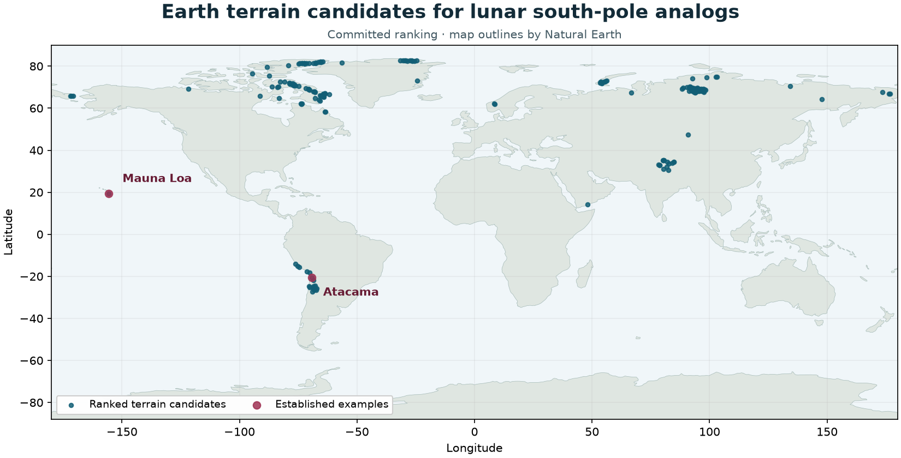

# Zodiak | Earth terrain analogs for the lunar south pole

Zodiak maps Earth terrain that resembles candidate lunar south-pole base regions. It ranks contiguous patches by local terrain similarity, identifies documented analogs, and exposes the evidence behind the score. Surface conditions and imagery show where each analogy breaks. A mission team could use the results to shortlist field sites for rover mobility or landing terrain rehearsals.

**Scope.** Zodiak searches Earth for terrain analogs of candidate base regions at the lunar south pole: the ranking reference is `base_regions`, the seven lunar south-pole candidate regions pooled (`pipeline/score.py`, `data/moon/reference.json`). Mars is a separate research direction, outside the ranking and its validation; the official contest title names both.



**1,758,778 valid cells** in **2,060 scanned tiles** with stored data yielded **3,175 candidate terrain patches**. The map shows the published ranking rather than the entire candidate catalogue. See [site ranking](data/sites/ranking.csv), [validation](docs/VALIDATION.md), and [number sources](docs/pitch/NUMBERS.md).

**Demo:** DEMO LINK PLACEHOLDER. *DECISION FOR THE TEAM: hosting of the web app in `app/` and the public demo link (issue #11).*

## What we found, in short

1. **What is measured.** The shape of the terrain between about 200 m and 1.6 km inside 2 km cells: slopes over 240 m and 570 m, roughness over 200 m to 1.6 km, and closed depressions. Nothing smaller than about 100 m (boulders, small craters, the slopes a rover meets) and nothing about rock, regolith, temperature or light enters the score.
2. **The default ranking** keeps cells that ESA WorldCover marks as "bare / sparse vegetation" or "moss and lichen". Its top 30 is mostly Arctic plateaus (16 sites on the Putorana Plateau in Siberia, then north Greenland and Arctic Canada), and that ground is **mostly moss-and-lichen tundra, not bare rock**.
3. **The strict ranking** counts only "bare / sparse vegetation". Only **3 of the default top 30** have a site of the strict top 30 within 3 km. The strict top 30 is the Atacama and Puna (13), the western Tibetan Plateau including Ladakh (8), the coastal desert of southern Peru and Arica (4), the Hazen Plateau on northern Ellesmere Island (3), Mauna Loa (1) and one other site. We show both rankings; the strict one is the conservative reading. *DECISION FOR THE TEAM: which ranking is the headline (issue #11).*
4. **What validation shows.** At the scale of one-degree tiles the score does not pick out known analog tiles (AUC **0.531**, consistent with chance). Around the 22 known lunar analog sites the median enrichment of lunar-like ground is **1.02×** the scan-wide rate against **0.39×** for random circles, a borderline result: 2.8% of random runs reach it. Ranks are stable when the lunar sample is resampled (the top 10 moves by at most 3 places) and sensitive to the feature set (without roughness only 8 of the top 30 stay).
5. **Literature.** Of the strict top 30, 9 sites lie in known analog regions, 15 lie in regions that an opened page names as a **Mars** analog (none as a Moon analog), and 6 were "not found in the analog catalogues and searches listed here". Of the default top 30: 2, 4 and 24. These are SI-model checks that a person has not yet confirmed, and nothing here is called a discovery. [Literature check](docs/NOVELTY.md)

## How it works

1. Read the NASA LOLA south-pole elevation grid and bring it to a common pixel size with the Earth grid.
2. Build reference cells from seven candidate base regions, with separate references for each region.
3. Measure slope, roughness, and closed depressions with the same feature code on both bodies.
4. Check the lunar estimator against NASA's published slope map and compare the PDS and PGDA grids.
5. Scan selected Earth tiles with Copernicus elevation. Check a common subset against NASADEM.
6. Mask Earth cells using WorldCover bare-ground, ice and water fractions. Use MODIS land cover for the NASADEM comparison.
7. Score each cell by how far its feature vector lies from the distribution of lunar reference cells.
8. Join neighbouring candidates into sites and rank their best 15 × 15 km windows. A terrain rule puts patches with dune-like relief last and keeps them visible.
9. Attach imagery, climate and surface conditions for context alongside the lunar instrument products.
10. Compare with control tiles, known analogs, independent laser profiles and lidar. Review the leading regions against imagery and literature.

Similarity refers to terrain shape between about 200 m and 1.6 km inside 2 km cells; features smaller than about 100 m, including boulders and the slopes a rover or astronaut meets, are not measured ([rank uncertainty per site](data/sites/rank_uncertainty.csv)).

[Full method and decision rules](docs/METHOD.md) · [Literature review and human checks](docs/NOVELTY.md)

## Run from the repository root

```sh
python -m pip install -r requirements.txt
python -m pipeline.run --list
python -m pytest tests -q
```

The committed [ranking](data/sites/ranking.csv), [site polygons](data/sites/sites.geojson) and [map](docs/pitch/ranking-map.png) can be inspected without rescanning. Follow the [data catalogue](data/README.md) for individual rebuild stages. The [cloud runner guide](cloud/README.md) covers the large Earth scan. To regenerate the static map, run `python docs/pitch/build_ranking_map.py`. The [web app task](https://github.com/BartoszPreus/NASA/issues/3) tracks the interactive demo.

On Windows, if the checkout and system temporary directory live on different drives, run pytest with `--basetemp` pointing to a dedicated temporary directory on the checkout drive.

## Data and acknowledgements

### NASA data

| Provider | Source | Role in Zodiak | Credit / terms |
|---|---|---|---|
| NASA | NASA Earthdata Search · [source](https://search.earthdata.nasa.gov/) | Earth data discovery; ATL06 was accessed through SlideRule. | NASA Earthdata catalogue |
| NASA | NASA Worldview / GIBS · [source](https://wvs.earthdata.nasa.gov/) · [archive / access](https://worldview.earthdata.nasa.gov/) | Earth imagery around ranked sites. | Credit NASA GIBS, part of NASA ESDIS. |
| NASA | Harmonized Landsat Sentinel-2 (HLS) v2.0 true colour, layers HLS_S30 / HLS_L30 Nadir BRDF-Adjusted Reflectance, 30 m · [source](https://wvs.earthdata.nasa.gov/) · [product page](https://www.earthdata.nasa.gov/data/catalog/lpcloud-hlss30-2.0) | Close-up images for the review of the strict top 30 (job J40), read through NASA Worldview Snapshots. | Credit NASA GIBS, part of NASA ESDIS; NASA LP DAAC HLS. The HLS citation and DOI are UNVERIFIED (the product page returned HTTP 403 on 15 Nov 2026, `docs/sources/j40.md`). |
| NASA | NASA Planetary Data System · [source](https://pds.nasa.gov/) | Archive for LRO lunar products. | Credit the data providers named below. |
| NASA | LRO LOLA gridded polar DEM · [source](https://pds-geosciences.wustl.edu/lro/lro-l-lola-3-rdr-v1/lrolol_1xxx/data/lola_gdr/polar/img/ldem_80s_80m.img) | PDS elevation grid compared with the PGDA grid from the same instrument. | Smith et al. and the LRO LOLA team; NASA PDS. |
| NASA | LRO Mini-RF south-pole SAR · [source](https://pds-geosciences.wustl.edu/lro/lro-l-mrflro-4-cdr-v1/lromrf_0005/data/sar/mosaics/) | Lunar radar context. | NASA PDS and the Mini-RF team. |
| NASA | LRO LEND neutron counts · [source](https://pds-geosciences.wustl.edu/lro/lro-l-lend-2-edr-v1/lrolen_0xxx/) | Lunar neutron context, an indirect proxy for hydrogen. | NASA PDS and the LEND team. |
| NASA | LRO LROC WAC imagery · [source](https://pds.lroc.im-ldi.com/data/LRO-L-LROC-5-RDR-V1.0/LROLRC_2001/) · [archive / access](https://quickmap.lroc.im-ldi.com/) | Lunar optical context and visual checks. | NASA PDS and the LROC team. |
| NASA | LRO Diviner Polar Resource Product · [source](https://pds-geosciences.wustl.edu/lro/urn-nasa-pds-lro_diviner_derived1/data_derived_prp/dlre_prp_south.tab) | Modelled lunar temperature and depth to stable ice. | Paige et al., NASA PDS; [instrument paper](https://doi.org/10.1126/science.1187726). |
| NASA | LRO Diviner polar temperature maps · [source](https://pds-geosciences.wustl.edu/lro/urn-nasa-pds-lro_diviner_derived1/data_derived_pcp/) | Lunar thermal map context. | NASA PDS and the Diviner team. |
| NASA | LOLA south-pole elevation and effective resolution (PGDA 90) · [source](https://pgda.gsfc.nasa.gov/products/90) | Primary lunar terrain reference and its resolution. | Barker et al. (2023), [paper](https://doi.org/10.3847/PSJ/acf3e1), [data](https://doi.org/10.60903/gsfcpgda-lola-spole). |
| NASA | LOLA slope and roughness maps (PGDA 90) · [source](https://pgda.gsfc.nasa.gov/products/90) | Checks the lunar slope estimator and documents roughness differences. | Barker et al. (2023), [paper](https://doi.org/10.3847/PSJ/acf3e1), [data](https://doi.org/10.60903/gsfcpgda-lola-spole). |
| NASA | LOLA along-track slopes (PGDA 70) · [source](https://pgda.gsfc.nasa.gov/products/70) · [archive / access](http://imbrium.mit.edu/EXTRAS/FRACTAL/IMG/) | Lunar laser-profile comparison. | Rosenburg et al. (2011), [paper](https://doi.org/10.1029/2010JE003716). |
| NASA | LOLA illumination and Earth visibility (PGDA 69) · [source](https://pgda.gsfc.nasa.gov/products/69) | Lighting context for lunar regions. | Mazarico et al. (2011), [paper](https://doi.org/10.1016/j.icarus.2010.10.030). |
| NASA | LRO LAMP UV albedo · [source](https://planetarydata.jpl.nasa.gov/img/data/lro/lamp/gdr/LROLAM_2001/) | Lunar ultraviolet context. | NASA PDS and the LAMP team. |
| NASA | NASA POWER / MERRA-2 climatology · [source](https://power.larc.nasa.gov/api/temporal/climatology/point) · [archive / access](https://power.larc.nasa.gov/docs/referencing/) | Earth skin temperature, wind and precipitation context. | NASA Langley Research Center POWER, funded through NASA Earth Science Division. |
| NASA | ICESat-2 ATL06 v7 · [source](https://nsidc.org/data/atl06) | Laser-profile check of Earth grid slopes. | NASA NSIDC DAAC, [dataset DOI](https://doi.org/10.5067/ATLAS/ATL06.007). |
| NASA | NASADEM HGT v001 · [source](https://opentopography.s3.sdsc.edu/raster?list-type=2&prefix=NASADEM/NASADEM_be/) · [archive / access](https://portal.opentopography.org/datasetMetadata?otCollectionID=OT.032021.4326.2) | Alternative Earth elevation model for the comparison. | NASA JPL (2020), NASA EOSDIS LP DAAC, [DOI](https://doi.org/10.5067/MEaSUREs/NASADEM/NASADEM_HGT.001); accessed via OpenTopography. [LP DAAC citation](https://forum.earthdata.nasa.gov/viewtopic.php?t=5421). |
| NASA | MODIS MCD12Q1 v061 IGBP land cover · [source](https://gibs.earthdata.nasa.gov/wms/epsg4326/best/wms.cgi) · [archive / access](https://gibs.earthdata.nasa.gov/colormaps/v1.3/MODIS_IGBP_Land_Cover_Type.xml) | Alternative land-cover mask accessed via NASA GIBS. | Friedl & Sulla-Menashe (2022), NASA EOSDIS LP DAAC, [DOI](https://doi.org/10.5067/MODIS/MCD12Q1.061). [LP DAAC citation](https://forum.earthdata.nasa.gov/viewtopic.php?t=3393). |
| NASA | MODIS MOD11C1 v061 land surface temperature · [source](https://data.earth.jaxa.jp/stac/cog/v1/catalog.json) | Earth surface temperature from monthly normals served through JAXA Earth API. | Wan, Hook & Hulley (2021), NASA EOSDIS LP DAAC, [DOI](https://doi.org/10.5067/MODIS/MOD11C1.061). [LP DAAC record](https://www.earthdata.nasa.gov/data/catalog/lpcloud-mod11c1-061): openly shared without restriction under the EOSDIS Data Use and Citation Guidance. |
| NASA | NASA NSSDC Moon Fact Sheet · [source](https://nssdc.gsfc.nasa.gov/planetary/factsheet/moonfact.html) | Physical context for site comparisons. | NASA NSSDC. |
| NASA | NASA Earth Observatory, Star Dunes in Algeria · [source](https://science.nasa.gov/earth/earth-observatory/star-dunes-in-algeria-81996/) | Location reference for the Grand Erg Oriental RADARSAT-1 panel. | NASA Earth Observatory, Adam Voiland. |

We acknowledge imagery from NASA's Global Imagery Browse Services (GIBS), part of NASA's Earth Science Data and Information System (ESDIS). Credits for individual lunar instruments are in the [LRO product registry](data/moon/instruments/registry.json).

### Partner agency data

| Provider | Source | Role in Zodiak | Credit / terms |
|---|---|---|---|
| ESA | Copernicus DEM GLO-30 · [source](https://dataspace.copernicus.eu/) · [archive / access](https://registry.opendata.aws/copernicus-dem/) · [access](https://copernicus-dem-30m.s3.amazonaws.com/) | Primary Earth elevation grid. | [Copernicus DEM licence and attribution terms](https://dataspace.copernicus.eu/explore-data/data-collections/copernicus-contributing-missions/collections-description/COP-DEM); see credit below. |
| ESA | ESA Open Science Catalog · [source](https://opensciencedata.esa.int/) · [archive / access](https://esa-earthcode.github.io/open-science-catalog-metadata/catalog.json) | Discovery and provenance of the permafrost cube. | Catalogue metadata; dataset terms are separate. |
| ESA | ESA CCI permafrost, EarthCODE combined cube · [source](https://esa-earthcode.github.io/open-science-catalog-metadata/products/esa-cci-permafrost/collection.json) · [archive / access](https://deep-esdl-public.s3.eu-central-1.amazonaws.com/esa-cci-permafrost-1x1151x1641-1.0.0.zarr/) | Permafrost fraction and ground-temperature context. | [Versioned DOI](https://doi.org/10.83395/3ykt-y203). Data: ESA Permafrost Climate Change Initiative (Permafrost_cci). Terms: [ESA CCI Permafrost terms and conditions](https://artefacts.ceda.ac.uk/licences/specific_licences/esacci_permafrost_terms_and_conditions.pdf) (any user, any purpose; acknowledge the ESA Climate Change Initiative and the Permafrost CCI project). Which CCI release the cube holds is not stated on the cube record. |
| JAXA | JAXA G-Portal / Earth API · [source](https://gportal.jaxa.jp/gpr/index/index) · [archive / access](https://data.earth.jaxa.jp/en/) · [access](https://data.earth.jaxa.jp/stac/cog/v1/catalog.json) | Access to the temperature and soil moisture products below. | [JAXA data policy](https://earth.jaxa.jp/en/data/policy/) and [Earth API terms](https://data.earth.jaxa.jp/en/#license). |
| JAXA | GCOM-C / SGLI land surface temperature · [source](https://data.earth.jaxa.jp/stac/cog/v1/catalog.json) | Measured day and night Earth surface temperatures. | Credit: GCOM-C/SGLI Level-3 land surface temperature (JAXA). [Dataset DOI](https://doi.org/10.57746/EO.01gs73bfs5sbzhyxg4j9ytajsa). |
| JAXA | GCOM-W / AMSR2 soil moisture · [source](https://data.earth.jaxa.jp/stac/cog/v1/catalog.json) | Measured surface moisture context from the Earth API monthly normals. | Credit: GCOM-W/AMSR2 Level-3 soil moisture content (JAXA). [Source monthly product DOI](https://doi.org/10.57746/EO.01gs73b17zekqwyj4hh9xpqgy7). |
| JAXA | ALOS World 3D 30 m (AW3D30) DSM v4.1 · [source](https://doi.org/10.57746/EO.01kkfx0ejw8r5ndc9bg5nt13ws) | Third elevation model on ten reference tiles, a cross-check of Copernicus and NASADEM (job J29, `docs/sources/j29.md`). | ALOS World 3D - 30m (AW3D30) Global DSM (JAXA), obtained using JAXA Earth API; [JAXA data policy](https://earth.jaxa.jp/en/data/policy/). |
| ESA | ESA WorldCover 2021 v200 · [source](https://esa-worldcover.org) · [archive / access](https://registry.opendata.aws/esa-worldcover-vito/) | Primary bare-ground, ice and water mask; class definitions for the strict mask from the [Product User Manual v2.0](https://esa-worldcover.s3.eu-central-1.amazonaws.com/v200/2021/docs/WorldCover_PUM_V2.0.pdf), legend table (`docs/sources/j33.md`). | [CC BY 4.0 and map credit](https://esa-worldcover.org/en/data-access); Zanaga et al. (2022), [DOI](https://doi.org/10.5281/zenodo.7254221). |

The terrain ranking uses elevation grids. A separate comparison uses RADARSAT-1 data and the CSA radar tutorial to show regional radar texture beside LRO Mini-RF. We reviewed the RADARSAT Constellation Mission resource for a separate polarimetry comparison. [RADARSAT-1 data and licence](https://www.asc-csa.gc.ca/eng/satellites/radarsat1/data-access.asp) · [CSA tutorial](https://github.com/asc-csa/Synthetic_Aperture_Radar_Tutorial) · [RADARSAT Constellation Mission](https://www.asc-csa.gc.ca/eng/satellites/radarsat/access-to-data/about.asp) · [Radar comparison](docs/sources/j27.md)

This data was obtained using JAXA Earth API.

Copernicus attribution: produced using Copernicus WorldDEM-30 © DLR e.V. 2010-2014 and © Airbus Defence and Space GmbH 2014-2018 provided under COPERNICUS by the European Union and ESA; all rights reserved. [Provider terms](https://dataspace.copernicus.eu/explore-data/data-collections/copernicus-contributing-missions/collections-description/COP-DEM)

WorldCover map-layer credit: © ESA WorldCover project 2021 / Contains modified Copernicus Sentinel data (2021) processed by ESA WorldCover consortium. [Provider terms](https://esa-worldcover.org/en/data-access)

### Other sources and software

| Provider | Source | Role in Zodiak | Credit / terms |
|---|---|---|---|
| USGS | USGS 3DEP lidar · [source](https://prd-tnm.s3.amazonaws.com/StagedProducts/Elevation/1m/Projects/AZ_NorthEast_D23/TIFF/USGS_1M_12_x49y388_AZ_NorthEast_D23.tif) | Meteor Crater cross-section and resolution check. | USGS public-domain data. |
| USGS | USGS TNM Access API · [source](https://tnmaccess.nationalmap.gov/api/v1/products) | Finds the USGS elevation tile. | USGS public service. |
| USGS / IAU | USGS / IAU Gazetteer · [source](https://planetarynames.wr.usgs.gov/) | Coordinates and names of lunar regions. | Credit USGS and IAU. |
| GUGiK (Poland) | GUGiK NMT elevation model · [source](https://mapy.geoportal.gov.pl/wss/service/PZGIK/NMT/GRID1/WCS/DigitalTerrainModelFormatTIFF) | Morasko crater resolution example. | Credit GUGiK / geoportal.gov.pl. |
| Natural Earth | Natural Earth · [source](https://www.naturalearthdata.com/) · [archive / access](https://github.com/nvkelso/natural-earth-vector) | Country lookups and land outline on the ranking map. | Public-domain map data. |
| OpenStreetMap | OpenStreetMap Nominatim / Overpass · [source](https://nominatim.openstreetmap.org/) · [archive / access](https://overpass-api.de/api/interpreter) | Place names and geospatial context for the literature review. | © OpenStreetMap contributors, ODbL. |
| Wikipedia | Wikipedia · [source](https://en.wikipedia.org/w/api.php) | Background gazetteering and literature leads. | CC BY-SA; see the citations in the novelty report. |
| literature | Known analog literature · [site-by-site sources](data/reference/known_analogs.csv) | Published or documented analog locations. | Citations and evidence status per catalogue row. |
| literature | Lunar site literature · [source](https://www.hou.usra.edu/meetings/lpsc2024/pdf/1695.pdf) · [archive / access](https://arxiv.org/abs/2406.19863) | Candidate region coordinates and interpretation. | Gracy & Lee; Peña-Asensio et al.; see the linked papers. |
| literature | Strict top-30 literature check (J40) · [Radebaugh et al., EPSC 2022](https://meetingorganizer.copernicus.org/EPSC2022/EPSC2022-715.html) · [Tavernier et al., EPSC 2021](https://meetingorganizer.copernicus.org/EPSC2021/EPSC2021-452.html) · [ISRO HOPE analog mission](https://www.isro.gov.in/ISRO_EN/Space_Analog_Mission.html) · [Pandey et al. 2020, Ladakh](https://www.cambridge.org/core/journals/international-journal-of-astrobiology/article/ladakh-diverse-highaltitude-extreme-environments-for-offearth-analogue-and-astrobiology-research/F9FE95516A6B5D650333ABBCCF2F7512) · [Valdivia-Silva et al. 2011, Pampas de La Joya](https://cris.utec.edu.pe/en/publications/multidisciplinary-approach-of-the-hyperarid-desert-of-pampas-de-l/) · [Up Here 2019](https://uphere.ca/node/2310) · [Harris et al. 2022](https://www.frontiersin.org/articles/10.3389/fspas.2022.849078) · [Ngari geography page (weak, no source)](https://americageography.github.io/china-geography/tibet-geography/ngari-geography) | Mars-analog statements about the regions of the strict top 30. | Quoted sentences and status per page in `docs/sources/j40.md`. |
| Leaflet | Leaflet 1.9.4 · [source](https://leafletjs.com/) · [archive / access](https://github.com/Leaflet/Leaflet) | Map of the web app in `app/` (bundled copy in `app/vendor/`). | BSD-2-Clause, `app/vendor/LICENSE-Leaflet`. |
| SlideRule (Univ. of Washington) | SlideRule Earth · [source](https://slideruleearth.io/) | Access and subset ICESat-2 ATL06 data. | BSD-3-Clause; Shean et al., [software paper](https://doi.org/10.21105/joss.04982). |

The pipeline uses [Python](https://www.python.org/), [NumPy](https://numpy.org/), [SciPy](https://scipy.org/), [pandas](https://pandas.pydata.org/), [PyArrow](https://arrow.apache.org/), [Rasterio](https://rasterio.readthedocs.io/), [pyproj](https://pyproj4.github.io/pyproj/), [scikit-image](https://scikit-image.org/) and [Shapely](https://shapely.readthedocs.io/). The tools also use [Matplotlib](https://matplotlib.org/), [Pillow](https://python-pillow.org/), [ReportLab](https://www.reportlab.com/), [Requests](https://requests.readthedocs.io/), [Numcodecs](https://numcodecs.readthedocs.io/) and [pytest](https://docs.pytest.org/); [pypdf](https://pypdf.readthedocs.io/) was used once to read the legend page of the WorldCover manual (job J33, not in `requirements.txt`). See the [source register](data/sources.csv), [terrain feature references](docs/sources/j1.md) and [requirements](requirements.txt).

## Validation

| Check | Result and interpretation |
|---|---|
| Published NASA LOLA slope map | Median absolute error **0.042°** on the native DEM and **0.064°** after resampling for the plane-fit check. The ranking uses two-point slopes. |
| PDS and PGDA elevation grids | Median offset **+0.191 m**, RMS difference **1.709 m** between grids derived from LOLA. |
| Earth elevation sensitivity | Spearman **0.637** across **618** common tiles, with **21 of the top 50** shared. The comparison did not satisfy the rule for replacing Copernicus with NASADEM. |
| Known-site enrichment | Over the **22** known lunar analogs (tagged lunar or both; Mars-only entries excluded), median **1.02×** the bare-cell baseline versus **0.39×** around matched random circles (5–95%: 0.12–0.91); 14 of 500 random repeats reached the observed median. The typical known lunar analog's circle sits at about the scan-wide bare-cell rate. |
| Tile recovery | Known analog tiles against the scanned background: **AUC 0.531** (90% interval 0.396–0.668, 14 known tiles), consistent with chance. |
| Rank stability | Resampling the 1,575 lunar reference cells 200 times moves the top 10 by at most **3** places; a typical run keeps **28** of the top 30. Leaving one feature group out keeps **13** (no slopes), **8** (no roughness) and **21** (no depressions) of the top 30. [Per-site intervals](data/sites/rank_uncertainty.csv) |
| Negative controls | No candidates survived the land-cover mask in the four control tiles. |
| ICESat-2 | Across eight sites, laser slopes at **240 m** were **0.43–1.16×** their grid counterparts, median **0.87×**. Track and grid footprints differ. |
| Moss and lichen in the bare mask | The default mask counts WorldCover class 100 "moss and lichen" as bare. With class 60 "bare / sparse vegetation" only, **3 of the default top 30** sites have a site of the strict top 30 within 3 km (and **16 of the default top 100** one of the strict top 100). Candidate cells fall from **63,618** to **35,875**, sites from **3,175** to **1,561**, and Putorana Plateau sites from **228** to **1**. [Strict ranking](data/validation/landcover_sensitivity/ranking_bare_strict.csv) |
| Image review of the strict top 30 | NASA Worldview MODIS/VIIRS and 30 m HLS images: **28** not artefacts, **2** unsure (ranks 13 and 28), **0** artefacts; no footprint on a salt flat, dune field, lake bed or glacier. An SI model's verdict, not yet checked by a person. [Review table](data/validation/landcover_sensitivity/top30_strict_review.csv) |

At the scale of one-degree tiles, the score does not separate known analog sites from the rest of the scanned land. [Full validation report](docs/VALIDATION.md)

## Limits

**The top of the default ranking is mostly moss-and-lichen tundra, not bare rock.** The default land-cover mask counts ESA WorldCover class 100 "moss and lichen" as bare ground. With class 60 "bare / sparse vegetation" only, the Arctic plateaus that lead the ranking mostly drop out: none of the 16 Putorana Plateau sites in the top 30 remains, and only **3 of the default top 30** sites have a site of the strict top 30 within 3 km. The strict ranking is led by the Atacama and Puna (13 of its top 30), the western Tibetan Plateau (8), the coastal desert of southern Peru and Arica (4), the Hazen Plateau and northern Ellesmere Island (3) and Mauna Loa (1). We present both rankings: the default one and the [strict one](data/validation/landcover_sensitivity/ranking_bare_strict.csv) as the conservative reading. The default mask is unchanged ([numbers and keys](docs/VALIDATION.md)).

The scan favours selected, mostly bare land and cannot certify global coverage. Tundra lichen, river erosion, thaw basins and dunes can resemble lunar relief in a grid. Rankings depend on the elevation model and cell grid. Terrain similarity alone cannot establish regolith, thermal conditions, illumination, access or permission to conduct field work. The lunar analysis covers the south-pole targets. Mars remains a separate calibration task.

The temperature and moisture checks of 978 sites do not confirm that the dune-field flag marks dry sand; the flag stays a terrain rule. [Surface-data validation](docs/sources/j26.md)

The literature check is one to four English web searches per site row (mostly two). In the strict top 30, 9 sites are in known analog regions, 15 in regions an opened page names as a Mars analog, and 6 were "not found in the analog catalogues and searches listed here" (the three Hazen Plateau sites, Aksai Chin, Acarí and Marcona); "not found" is a weak negative, and none of these places is a discovery. Six of the "mentioned" rows (Ngari, Tibet) rest on a general geography page without a source. [Literature check](docs/NOVELTY.md)

## Next steps

RADARSAT Constellation Mission compact polarimetry (circular transmit, linear receive, the design of LRO Mini-RF) would give the circular polarisation ratio on Earth defined as on the Moon, but on 15 Nov 2026 we found no RCM scene we could use: the open RCM CEOS-ARD collection had no item over Devon Island (Haughton) or over the Canadian top sites, and a public EODMS account may download only detected GRD/GCD products of scenes entirely inside Canadian land borders, which does not give the complex data the ratio needs. A vetted RCM account (Canadian Space Agency) or a tasked acquisition would be needed; see [docs/sources/j28.md](docs/sources/j28.md).

## Team, SI and licence

**Team Zodiak** · Bartosz Preus, Hubert Włodzimierz Woźniak, Wiktor Witczak and Oliwier Gołembiewski · NASA Space Apps Poznań.

The team chose the problem, research goals and interpretation. Claude Code, Antigravity and OpenAI Codex assisted with implementation, checks, literature review and documentation. The ranking map and plots are rendered from data. Lunar and Earth imagery retain the credits above.

Project code is [Apache-2.0](LICENSE). Data and imagery retain the providers' respective terms.
